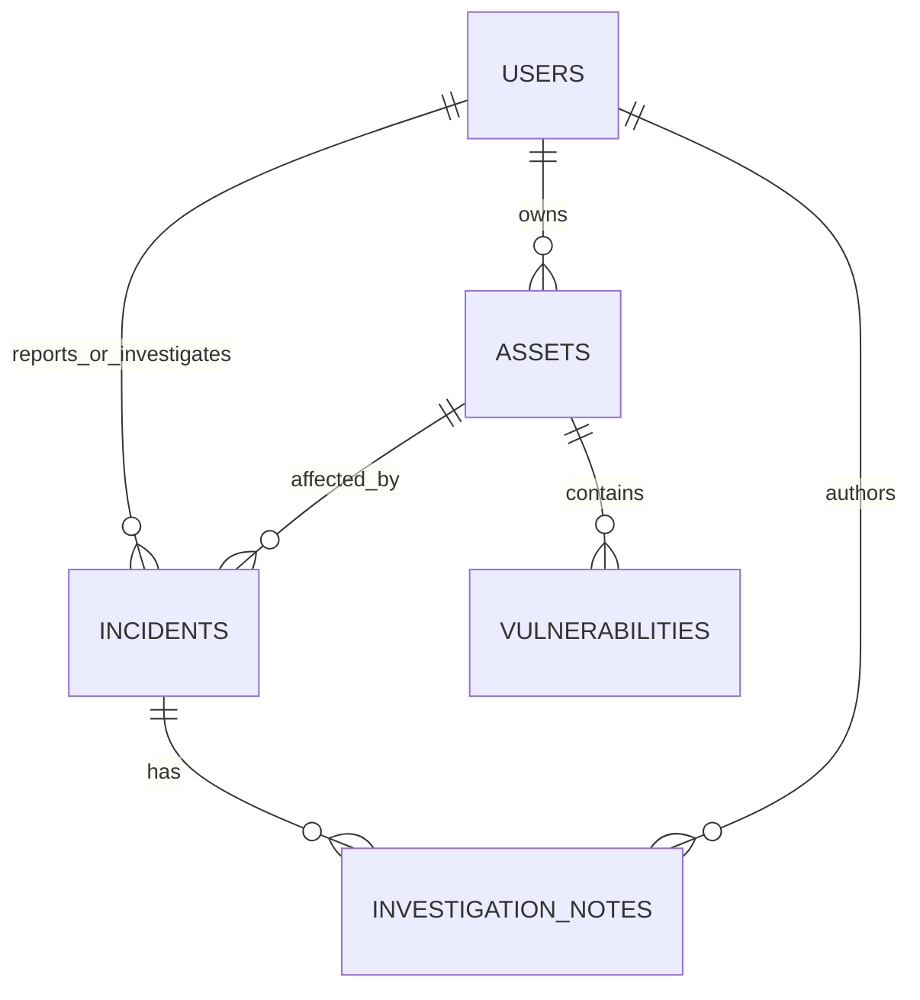

# Database plan

Joey's initial SQLite schema is [schema.sql](../joey/schema.sql). It defines Users, Assets, Asset History, Notifications and Outbox. It has primary keys; foreign keys from assets to owner and notifications to recipient; unique username/email and event ID; and role/status/type/severity checks. Referenced users cannot be deleted. Asset history survives asset deletion by retaining `original_asset_id`. If Christophe's incident/vulnerability tables use asset FKs with RESTRICT, deletion will return 409.

Karl Khouri's [schema](../karl/schema.sql) adds `audit_logs` (actor FK `ON DELETE SET NULL` plus `original_actor_user_id`, UPDATE-blocking trigger), `playbooks` (creator FK), `response_actions` (playbook FK `ON DELETE CASCADE`, assignee FK, `UNIQUE(playbook_id, step_order)`, status check) and `action_history` (kept after deletion through original IDs). Reports store no tables. Playbook creators and assignees cannot be deleted while referenced (409). Christophe's [schema](../christophe/schema.sql) adds `threats` with normalized `UNIQUE(type,value)`, `vulnerabilities` with affected-asset FK and CVSS/status constraints, `incidents` with reporter/analyst/asset FKs, and `investigation_notes` with incident/author FKs. All referenced user and asset deletions are restricted; notes belong to one incident. Services share the existing local SQLite topology; reports communicate by API.

Each owner documents their tables and relationships and captures real structure and record evidence. Karl leads the relationship diagram and migration integration guide after topology is agreed. Joey's tests create temporary records; no submitted database screenshots exist yet.

Christophe: the real nine-process integration check verified `PRAGMA integrity_check`, `foreign_key_check`, stored notes, resolution dates, notifications and audit records. The check uses a disposable database and does not supply the required database screenshots. All own tables are created idempotently on service startup; schema, field and relationship details are in [Christophe API guide](christophe-api.md).

Christophe's relationship contribution for the team's common diagram:

Threat indicators have independent unique type/value identities; the brief does not require a threat-to-incident FK. The common report must also include Joey/Karl's remaining relationships and field-level PK/FK details.
